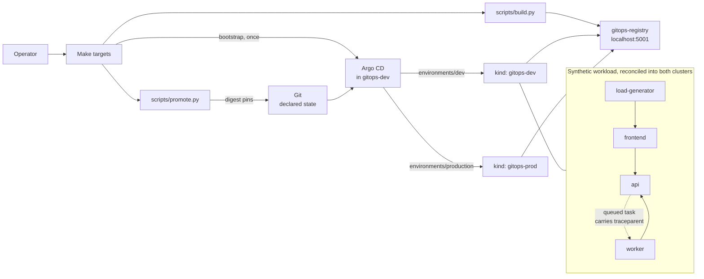

# EKS GitOps Reliability Platform

A local-first reference platform for proving repeatable Kubernetes environment
bootstrapping, a verifiable artifact supply chain, GitOps delivery whose drift
claim is tested rather than asserted, and digest-only environment promotion
through reviewed Git changes — before adding progressive rollout,
observability, security policy, or AWS infrastructure.

> **Current status: M4 environment promotion.** The implemented platform consists
> of two local kind clusters, one local container registry, four synthetic
> services built as digest-identified images with SBOM and provenance
> attestations, an Argo CD control plane that reconciles both environments from
> Git, and a promotion tool that writes immutable digests into environment
> overlays without talking to a cluster. Features described as **planned** are
> not implemented and must not be inferred from the repository name.

## Architecture at a glance



The platform currently demonstrates seven capabilities:

1. Repeatable creation of two isolated Kubernetes environments.
2. A shared local registry with mirror/discovery configuration for both
   clusters and no cloud credentials.
3. A bounded cleanup path that removes only project-managed local resources.
4. Four synthetic services with correlated metrics, structured logs, and W3C
   trace propagation that survives an asynchronous queue boundary.
5. A build that produces immutable digests with SBOM and provenance
   attestations, gated by a documented vulnerability policy.
6. Declarative Argo CD delivery to both environments, with an automated test
   that injects drift and requires the cluster to converge back to Git.
7. Digest-only promotion and rollback through Git, with a tested production
   approval boundary and no pipeline path to `kubectl` against a cluster.

See [Architecture](docs/architecture.md) for the component and ownership model,
and [GitOps delivery](docs/gitops.md) for how a commit reaches a cluster.

## Five-minute local quickstart

### Prerequisites

- Docker Engine or Docker Desktop is running.
- GNU Make, Bash, Python 3.13, kind, kubectl, and curl are available on `PATH`.
- The Docker daemon has enough capacity for two single-node kind clusters.

On Windows, the lifecycle also has a native PowerShell 7 path, so Bash and GNU
Make are not required merely to create or inspect the clusters. Python 3.13 is
still required for repository verification.

From an existing checkout:

```sh
cd eks-gitops-reliability-platform
make doctor
make verify
make up
make smoke
```

Native PowerShell 7 lifecycle equivalent:

```powershell
pwsh -File scripts/platform.ps1 doctor
python scripts/verify.py
pwsh -File scripts/platform.ps1 up
pwsh -File scripts/platform.ps1 smoke
```

For native PowerShell status and cleanup, use
`pwsh -File scripts/platform.ps1 status` and
`pwsh -File scripts/platform.ps1 down`.

Inspect the local environments without changing them:

```sh
kind get clusters
kubectl config get-contexts
```

Build the four service images and record their digests:

```sh
make images
cat artifacts/images.json
```

Hand both environments over to Argo CD. The repository URL is written into the
tracked manifests and committed, because Argo CD reconciles what is in Git and
would revert a value injected at apply time:

```sh
make configure REPO_URL=https://github.com/<you>/eks-gitops-reliability-platform.git
git commit -am "Point Argo CD at this repository"
make bootstrap
make gitops-wait
```

Then prove the drift claim instead of asserting it. This scales a Deployment
and deletes a Service by hand, and fails if Argo CD does not put both back:

```sh
make drift-test
cat artifacts/drift-test.json
```

Pin the just-built digests into development, then copy the same bytes into
production. Neither command talks to a cluster:

```sh
make push
make promote ENV=dev
make promote ENV=production FROM_ENV=dev CONFIRM=production
git diff environments
```

Rollback restores the previous recorded digest set:

```sh
make rollback ENV=dev
```

Remove the project-managed local resources when finished:

```sh
make down
```

PowerShell users can instead run `pwsh -File scripts/platform.ps1 down`.

`make up` and `make down` are designed to be safe to repeat. If bootstrap does
not complete, follow the
[local bootstrap failure runbook](docs/runbooks/local-bootstrap-failure.md).

## What is implemented

| Capability | Status | Evidence boundary |
|---|---|---|
| Two local kind environments | Implemented in M1 | `gitops-dev` and `gitops-prod` lifecycle and topology checks |
| One cluster-configured local registry | Implemented in M1 | Host API smoke at `localhost:5001`; static mirror/discovery contract for `gitops-registry:5000` |
| Prerequisite and reserved-name checks | Implemented in M1 | `make doctor` |
| Read-only runtime status and health | Implemented in M1 | `make status`, `make smoke` |
| Credential-free static/unit verification | Implemented in M1 | `make verify`; no Docker or cluster required |
| Idempotent lifecycle verification | Implemented in M1 | `make verify-local`: up twice, smoke, down twice |
| Four synthetic services | Implemented in M2 | 200 offline unit tests |
| Deterministic fault injection | Implemented in M2 | Exact failure schedule asserted; used by the planned M5 canary test |
| Immutable digest-identified images | Implemented in M2 | `make images`; `artifacts/images.json` records digests |
| SBOM and provenance attestations | Implemented in M2 | `make push`; the build workflow fails if attestation manifests are absent |
| Vulnerability gate | Implemented in M2 | `make scan` blocks fixable HIGH/CRITICAL and records unfixed findings |
| Metrics, structured logs, trace propagation | Implemented in M2 (encoding only) | Exposition, W3C context, and OTLP/JSON asserted in tests; **no collector or dashboards exist yet** |
| Declarative Argo CD bootstrap | Implemented in M3 | `make bootstrap` is idempotent and is also the upgrade path; the installation itself is not self-managed ([ADR 0005](docs/adr/0005-argo-cd-manages-everything-except-itself.md)) |
| App-of-apps and per-environment ApplicationSet | Implemented in M3 | One root Application generates `platform-dev` and `platform-production`; the root manages its own manifest |
| Scoped AppProjects | Implemented in M3 | `workloads` is confined to one namespace and seven kinds, with `Secret` blacklisted; tests assert the whitelist covers what the overlays render |
| Drift detection and self-heal | Implemented in M3 | `make drift-test` injects a mutation and a deletion and fails unless both are reverted; **runtime evidence not yet captured in this repository** |
| Digest-based environment promotion | Implemented in M4 | `make promote` writes overlay digests; production copies from another environment and requires `--confirm production` |
| Production approval gate | Implemented in M4 | CI requires `PROMOTION-CONFIRM: production` in the pull request body when production pins change |
| Rollback to a previous digest | Implemented in M4 | `make rollback` restores the previous history entry; the first promotion cannot roll back to the bootstrap tag |
| Pipeline isolation from the cluster | Implemented in M4 | Workflows and `scripts/promote.py` are scanned for cluster-mutation verbs; CI holds `contents: read` only |
| Argo Rollouts canary analysis and rollback | Planned for M5 | No rollout controller or metric analysis yet |
| Collector, dashboards, and SLOs | Planned for M6-M7 | No observability stack is deployed |
| Admission policy, network policy, and secrets integration | Planned for M8 | No policy controller yet |
| Autoscaling and cost attribution | Planned for M9 | No capacity claim yet |
| Resilience game days | Planned for M10 | Only bootstrap recovery is documented |
| Terraform-managed EKS | Optional and planned for M11 | No AWS resources are created |

## Documentation

- [Architecture](docs/architecture.md)
- [GitOps delivery](docs/gitops.md)
- [Environment promotion](docs/promotion.md)
- [Threat model](docs/threat-model.md)
- [Cost model](docs/cost-model.md)
- [Testing strategy](docs/testing-strategy.md)
- [M1 demo script](docs/demo-script.md)
- [Operational readiness](docs/operational-readiness.md)
- [ADR 0001: local kind before EKS](docs/adr/0001-local-kind-before-eks.md)
- [ADR 0002: GitOps ownership boundaries](docs/adr/0002-gitops-ownership-boundaries.md)
- [ADR 0003: immutable artifact promotion](docs/adr/0003-immutable-artifact-promotion.md)
- [ADR 0004: standard-library service runtime](docs/adr/0004-standard-library-service-runtime.md)
- [ADR 0005: Argo CD manages everything except itself](docs/adr/0005-argo-cd-manages-everything-except-itself.md)
- [Local bootstrap failure runbook](docs/runbooks/local-bootstrap-failure.md)
- [Application out of sync runbook](docs/runbooks/application-out-of-sync.md)
- [Failed promotion runbook](docs/runbooks/failed-promotion.md)
- [Rollback runbook](docs/runbooks/rollback.md)
- [Security policy](SECURITY.md)
- [Contributing guide](CONTRIBUTING.md)

## Security and cost warning

M1 creates Docker containers, networking, kubeconfig contexts, and local
registry storage on the workstation. Treat cluster-admin kubeconfigs and access to the
Docker daemon as privileged. Do not use production credentials or sensitive
data in this platform. The implemented path makes no cloud API calls and creates
no AWS billable resources; local compute, storage, and electricity still have a
cost. See the [threat model](docs/threat-model.md) and
[cost model](docs/cost-model.md).

## Project principles

- Git is the declared source of truth; a change made with kubectl is drift, and
  drift is reverted.
- Build an artifact once, identify it by digest, and promote configuration.
- Cloud deployment remains optional; the local verification path must continue
  to work without AWS credentials.
- Claims in documentation must be backed by reproducible repository evidence.
- Official projects are design references, not source to rename or represent as
  proprietary work.

This repository is a public reference implementation, not an AWS, Cloudflare,
or GitHub internal system.
