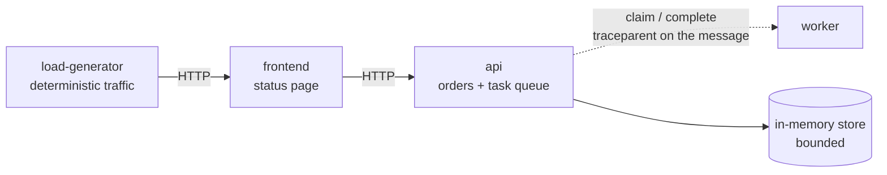
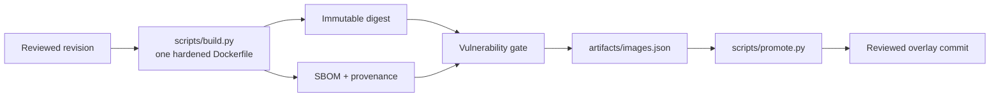
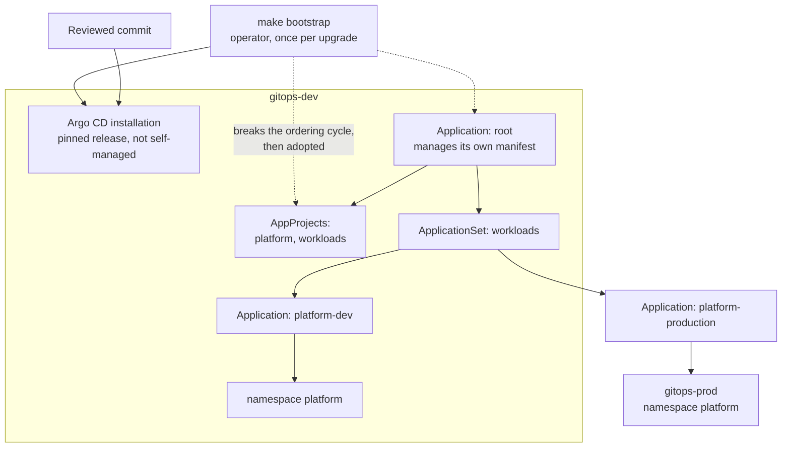
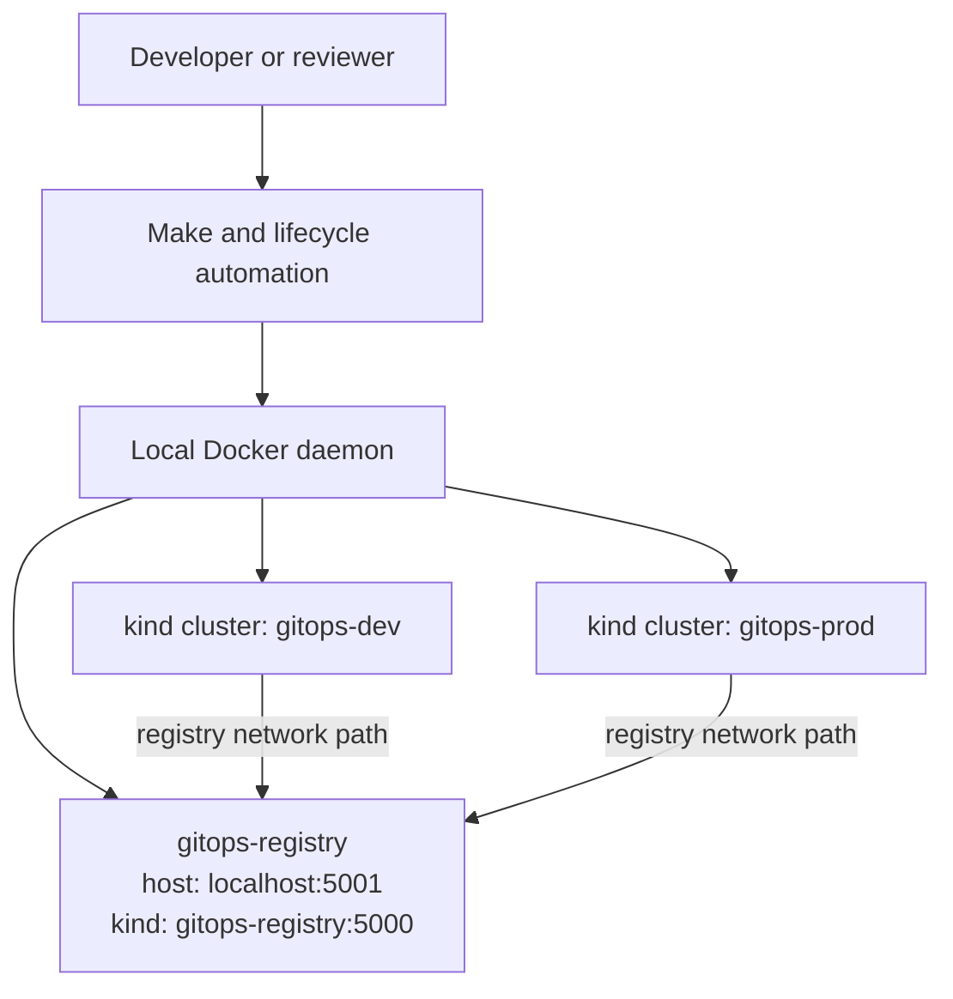
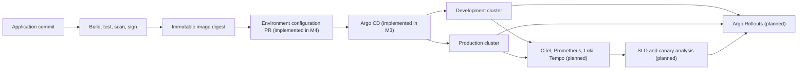

# Architecture

## Status and scope

The current architecture is deliberately small: two single-node kind clusters,
`gitops-dev` and `gitops-prod`, model development and production. One local
Docker registry, `gitops-registry`, is reachable from the host at
`localhost:5001` and from kind nodes at `gitops-registry:5000`. Lifecycle
automation supplies the stable interface through `make doctor`, `make up`,
`make status`, `make smoke`, `make down`, and credential-free `make verify`.

M2 adds four synthetic services and the build that turns them into immutable,
attested artifacts.

M3 adds the reconciler. An Argo CD control plane in `gitops-dev` reconciles
both environments from committed manifests, and `make drift-test` requires the
cluster to converge back to Git after a manual change. Delivery is described in
[GitOps delivery](gitops.md); the installation boundary is
[ADR 0005](adr/0005-argo-cd-manages-everything-except-itself.md).

M4 adds promotion. `scripts/promote.py` writes digest pins into environment
overlays and records history. Production copies pins from another environment
and requires an explicit confirmation. The tool never contacts a cluster.
The procedure is in [Environment promotion](promotion.md).

No progressive-delivery controller, observability backend, admission-policy
engine, autoscaler, Terraform-managed AWS infrastructure, or EKS cluster
exists. Those components are planned and are shown separately below.

## Workload architecture

| Service | Responsibility | Deliberately does not |
|---|---|---|
| `frontend` | Render the running version, upstream health, and recent orders | Hold state or talk to the worker |
| `api` | Validate orders, own the bounded queue, inject deterministic faults | Persist across restarts |
| `worker` | Claim tasks, process them, report the outcome | Decide retry policy; the API requeues stale claims |
| `load-generator` | Offer a fixed, reproducible request rate and composition | Randomise traffic |

Three properties of this design exist to serve later milestones:

- **The queue carries `traceparent`.** A task records the trace context of the
  request that created it, so M6 can show one trace spanning the synchronous
  call and the asynchronous processing. Parenting the worker span to its poll
  instead would produce one useless trace per tick.
- **Faults are scheduled, not random.** The API fails an exact, repeatable
  subset of requests, so M5's canary rollback either happens every run or never
  does. A flaky rollback test is not evidence.
- **Claims expire.** A worker lost mid-task leaves its claim behind; the API
  returns the task to the queue rather than stranding the order in
  `processing`, which is what makes queue depth an honest backlog signal.

The API stays ready when the worker is unavailable. Readiness answers "can this
replica serve", and removing the API from service during a worker outage would
convert partial degradation into a full outage while hiding the real cause.

## Artifact supply chain

All four services share one parameterised Dockerfile. Four near-identical files
drift, and the one that drifts is the one that keeps root or loses
`PYTHONDONTWRITEBYTECODE` and then fails under a read-only root filesystem. A
single definition makes the hardening contract impossible to apply
inconsistently and lets one test assert it.

The build records digests; it does not write environment configuration.
Producing an artifact and promoting one are separate actions with different
approval requirements, as required by
[ADR 0003](adr/0003-immutable-artifact-promotion.md). M4's promotion tool
edits overlays and history files only. See [Environment promotion](promotion.md).

## Delivery architecture

Three decisions in that picture are worth stating plainly.

**The installation is not reconciled by the thing it installs.** If Argo CD
manages its own Deployment, the controller that would revert a failed upgrade
is the controller being upgraded. The version is still a reviewed commit; it is
applied by an operator re-running `make bootstrap`. ADR 0005 records the trade.

**The root Application lives inside the path it syncs.** Once bootstrapped, the
only way to change the root is a commit — including changing it back after
somebody edits it by hand.

**Environment difference is confined to the overlay.** `platform/workloads/base`
holds no environment name, no replica count that survives, and no real image
tag. Everything that differs between `dev` and `production` is in
`environments/<name>/kustomization.yaml`, which is also the file a promotion
changes. Settings reach the pods through a generated ConfigMap whose name
carries a content hash, so changing a value rolls the deployment instead of
leaving pods running with stale configuration.

The AppProjects are the blast radius. `workloads` may create seven kinds in one
namespace on two named clusters, holds no roles, and blacklists `Secret`.
`platform` is permitted cluster-scoped resources because add-ons need CRDs, and
so its membership is kept to the root Application alone.

## Problem

Platform changes need a fast, reproducible place to exercise isolation,
promotion, policy, telemetry, and failure behavior. Beginning with EKS would
make the feedback loop slower, require credentials, and incur cloud cost before
the platform contracts are stable. M1 establishes the local lifecycle and
environment boundary on which later milestones can build.

## M1 context

## Component responsibilities

| Component | Current responsibility | Does not currently do |
|---|---|---|
| Lifecycle automation | Create, inspect, verify, and remove the named local resources | Provision AWS or deploy workloads |
| Build automation | Produce digest-identified, attested artifacts and a scan report | Change environment configuration or deploy |
| Bootstrap automation | Install Argo CD, register the managed cluster, apply the root Application | Reconcile anything; it runs once per upgrade |
| Promotion automation | Write digest pins into overlays and record history | Talk to a cluster, rebuild an artifact, or skip production confirmation |
| Argo CD | Reconcile projects, generators, and both environments from Git | Manage its own installation, build artifacts, or cluster lifecycle |
| Synthetic services | Exercise promotion, canary, telemetry, policy, and scaling | Persist data or serve real traffic |
| Development cluster | Represent a non-production Kubernetes environment | Prove production scale or availability |
| Production cluster | Represent a stricter promotion destination | Carry real production traffic or data |
| Local registry | Provide one local artifact endpoint for both clusters | Supply authentication, signing, provenance, or durable production storage |
| Docker daemon | Host registry and kind nodes on one workstation | Provide a multi-host failure domain |

The two clusters are separate Kubernetes API and reconciliation domains, but
they share the host, Docker daemon, registry, CPU, memory, disk, and network.
Consequently, M1 proves logical separation and lifecycle behavior, not physical
or regional isolation.

## Interfaces and invariants

- `make doctor` checks runtime prerequisites and reserved-name conflicts without
  changing the topology.
- `make up` converges the workstation toward the complete M1 topology.
- `make status` reports local state without changing it.
- `make smoke` verifies registry and cluster readiness without changing the
  topology.
- `make verify` runs static and unit checks without Docker, a cluster, cloud
  credentials, or runtime mutation.
- `make verify-local` exercises repeated create, smoke, and cleanup behavior.
- `make promote` / `make rollback` edit tracked overlays only; they do not
  contact a cluster.
- `make down` removes only resources owned by this project and is repeatable.
- Both cluster APIs must be independently addressable through kubectl contexts.
- Both clusters must resolve and reach the same local registry endpoint.
- M1 must not require AWS credentials or make AWS API calls.
- Automation must not delete unrelated kind clusters, containers, networks, or
  kubeconfig contexts.

On Windows, `scripts/platform.ps1` exposes the same `doctor`, `up`, `status`,
`smoke`, and `down` lifecycle actions. `make verify` is the portable repository
contract; its direct native equivalent is `python scripts/verify.py`.

## Ownership boundaries

[ADR 0002](adr/0002-gitops-ownership-boundaries.md) defines the boundary and M3
implements it: lifecycle tooling owns clusters and bootstrap prerequisites;
Argo CD owns declarative in-cluster platform and workload resources. CI
verifies and proposes configuration changes; it does not deploy to production
with kubectl, and it holds no cluster credentials.

The local topology places the control plane inside `gitops-dev`, so losing the
development cluster also loses the reconciler for production. That is a
single-host convenience, recorded as such in ADR 0002, and must be reassessed
before any EKS deployment.

Artifact movement is implemented in M4. [ADR 0003](adr/0003-immutable-artifact-promotion.md)
requires releases to promote immutable digests through reviewed configuration
changes. `scripts/promote.py` is that change. CI validates it and cannot apply
it.

## Planned target architecture

The following diagram is a roadmap and must not be interpreted as implemented:

An optional later deployment may replace kind clusters with EKS while retaining
the GitOps and artifact-promotion contracts. Local verification remains a
first-class path.

## Failure domains

| Failure | M1 effect | Response |
|---|---|---|
| Docker daemon unavailable | Both clusters and registry unavailable | Restore Docker, then rerun bootstrap |
| Local registry unavailable | Both environments lose the shared artifact endpoint | Reconcile the registry and rerun `make smoke` |
| One kind control plane fails | One modeled environment unavailable | Recreate only the affected project cluster |
| Host resource exhaustion | Either or both clusters may become unhealthy | Free capacity, inspect events, retry safely |
| Partial bootstrap | Topology may contain a subset of resources | Run the failure runbook; convergence must be safe |
| `gitops-dev` lost | Reconciliation stops for **both** environments; running production workloads continue unmanaged | Recreate the cluster and re-run `make bootstrap`; the shared failure domain is accepted locally and reassessed for EKS |
| Argo CD unable to reach the repository | No new state is applied; existing state is not reverted | `ComparisonError` in the runbook below; the cluster holds its last good state |
| `gitops-prod` credential invalid | `platform-production` degrades; dev is unaffected | Re-run `make bootstrap`, which rewrites the cluster Secret |

See the
[local bootstrap failure runbook](runbooks/local-bootstrap-failure.md) and the
[application out of sync runbook](runbooks/application-out-of-sync.md) for the
operator procedures.

## Architecture evidence

For M1, acceptable evidence is command output showing:

- Successful `make up` from a clean state.
- Project-managed clusters `gitops-dev` and `gitops-prod` are healthy through
  contexts `kind-gitops-dev` and `kind-gitops-prod`.
- Registry `gitops-registry` is running and its host API responds; static tests
  validate the documented kind mirror/discovery contract.
- A second `make up` succeeds without duplicating resources.
- `make verify` succeeds.
- Repeated `make down` succeeds and leaves unrelated resources untouched.

For M2, acceptable evidence is:

- `make verify` passing offline, exercising the real service code.
- `artifacts/images.json` listing one immutable digest per service.
- A build run in which the attestation check finds SBOM and provenance
  manifests for every image.
- `artifacts/vulnerability-report.json` showing the blocking and unfixed sets.

M2 evidence is limited to build-time and offline behavior. The services have
not been run in a cluster, no collector has received a span, and no dashboard
exists. The repository therefore claims that the telemetry **encodings** are
correct, not that an end-to-end telemetry pipeline is proven; that claim
belongs to M6.

For M3, the acceptable evidence is split by what the authoring environment can
produce.

Static, reproducible offline with `make verify`:

- 39 manifest contract assertions covering kustomization integrity, AppProject
  guardrails, cluster references, overlay parity, and pod hardening.
- The assertion that no `ignoreDifferences` rule hides `.spec.replicas`, which
  is the setting that would silently void the drift test.

Runtime, **not yet captured in this repository** because Docker, kind, and
kubectl are unavailable where it was authored:

- `make gitops-status` reporting `root`, `platform-dev`, and
  `platform-production` as `Synced` and `Healthy`.
- `artifacts/drift-test.json` with `"passed": true` for the mutation and
  deletion cases, including measured heal times.
- A second `make bootstrap` succeeding without change.

The distinction is deliberate. M3 substantiates that the delivery manifests are
internally consistent and that the drift test would fail if reconciliation did
not work; it does not yet substantiate that reconciliation was observed here.

For M4, acceptable evidence is offline and part of `make verify`:

- Promotion, production isolation, rollback, and pull-request gate tests in
  `tests/unit/test_promote.py`.
- A scan that fails if GitHub workflows or the promotion tool apply to a
  cluster.
- Overlay contract tests that every pin is either `0.0.0-bootstrap` or a
  `sha256:` digest, never a mix.

Runtime promotion evidence is a reviewed commit whose overlay pins match a
build manifest and whose Applications report Synced after merge. That evidence
requires Docker and is not attached until it exists. Committed overlays still
carry the bootstrap placeholder so a clone is a defined pre-promotion state,
not a fake digest.

Canary rollback, telemetry pipelines, policy, load, chaos, and EKS evidence are
deferred to their named milestones. No milestone so far pulls a synthetic image
from inside each cluster, so no end-to-end in-cluster image-pull test is
claimed.
