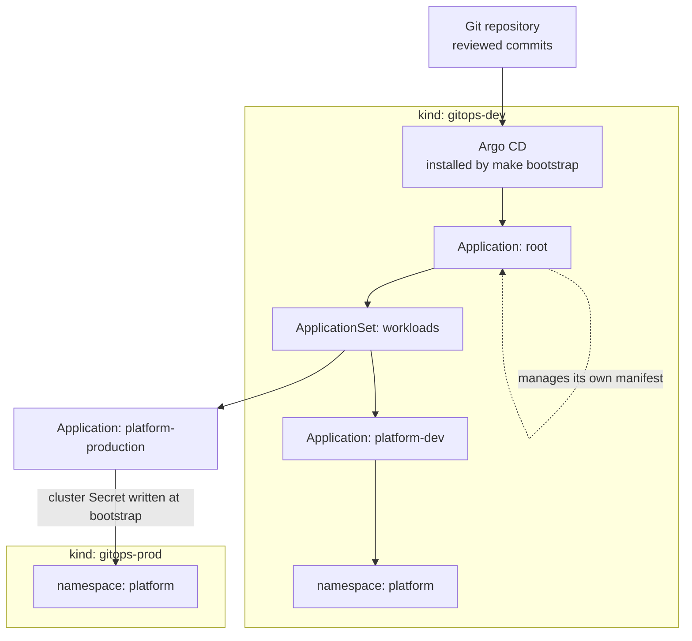

# GitOps Delivery

How the committed state in this repository reaches the two local clusters, what
Argo CD owns, and how the ownership claim is tested.

Read [ADR 0002](adr/0002-gitops-ownership-boundaries.md) for the ownership
contract and [ADR 0005](adr/0005-argo-cd-manages-everything-except-itself.md)
for why the Argo CD installation is outside it.

## Topology



Argo CD runs only in `gitops-dev` and manages `gitops-prod` remotely. That is a
single-host convenience with a real consequence: losing the development cluster
also loses the control plane for production. ADR 0002 records it as a
deliberate local-demo choice, not a recommended production topology.

## What lives where

| Path | Contains | Managed by Argo CD |
|---|---|---|
| `platform/argocd/install` | Pinned upstream Argo CD release plus three ConfigMap patches | No — applied by `make bootstrap` |
| `platform/argocd/root/projects` | The `platform` and `workloads` AppProjects | Yes, after the first sync |
| `platform/argocd/root/root-application.yaml` | The app-of-apps entry point | Yes, it manages itself |
| `platform/argocd/root/workloads-applicationset.yaml` | Generates one Application per environment | Yes |
| `platform/workloads/base` | The four services, environment-independent | Yes, through the overlays |
| `environments/dev`, `environments/production` | Everything that differs per environment | Yes |

The base is not deployable on its own. `PLATFORM_ENVIRONMENT` is unset there
and the image tag is a bootstrap placeholder, so an overlay must supply both. A
base that happens to work unmodified invites someone to apply it directly and
skip the environment boundary.

## Projects are the blast radius

Two AppProjects, with deliberately different reach:

- **`platform`** may create cluster-scoped resources, because add-ons install
  CRDs and ClusterRoles. Membership is the privileged path, so it stays small:
  today it holds only the root Application.
- **`workloads`** is confined to the `platform` namespace on each environment
  cluster and to the seven resource kinds an application legitimately owns.
  `Secret` is explicitly blacklisted; a workload that needs one will get it
  through the External Secrets pattern in M8. `roles: []` means a workload
  cannot widen its own permissions.

`tests/unit/test_gitops_contract.py` checks that the `workloads` whitelist
actually covers every kind the base renders. A whitelist that omits a kind you
deploy does not fail at review time — it fails as a sync error, minutes later,
in a cluster.

## Configuration, not flags

Argo CD reconciles what is committed. If the bootstrap injected a repository
URL at apply time, the committed manifests would still hold the placeholder and
Argo CD would revert to it on the next sync. So the URL is written into the
tracked files and committed:

```sh
make configure REPO_URL=https://github.com/<you>/eks-gitops-reliability-platform.git
git commit -am "Point Argo CD at this repository"
```

`make bootstrap` refuses to run while `REPLACE_ME_REPO_URL` remains in any of
the four manifests that carry it. Re-pointing the repository later is the same
command; `configure` replaces the previous value as well as the placeholder.

## Bootstrap

```sh
make up                    # registry and both kind clusters
make configure REPO_URL=…  # then commit and push
make bootstrap
make gitops-wait
make gitops-status
```

`make bootstrap` is idempotent and is also the Argo CD upgrade path. It:

1. refuses to touch a cluster lacking this project's ownership label;
2. applies the pinned Argo CD installation into `gitops-dev` and waits for the
   rollout;
3. reads the `gitops-prod` kubeconfig with `kind get kubeconfig --internal` and
   pipes a cluster Secret into the control-plane cluster — the credential never
   touches the working tree, so it cannot be committed;
4. applies the two AppProjects, then the root Application.

Step 4 is ordered that way because Argo CD rejects an Application whose project
does not exist, and the `platform` project is defined inside the root
Application's own path. Applying the projects first breaks the cycle; Argo CD
adopts them on the first sync and reverts any later hand edit.

To bootstrap without the production cluster:

```sh
python scripts/gitops.py bootstrap --skip-managed-cluster
```

The `platform-production` Application will then report as unhealthy, because
the cluster it targets is not registered. That is the correct report, not a bug.

Open the UI with:

```sh
kubectl --context kind-gitops-dev --namespace argocd \
  port-forward svc/argocd-server 8080:443
```

The default RBAC policy is `role:readonly`. `role:platform-operator` may sync
`platform-dev` but not `platform-production`: a production change goes through
a reviewed commit, and a UI sync button that deploys unreviewed state would
erase that boundary.

## Changing something

| Change | Where |
|---|---|
| Application behaviour | `apps/…`, then rebuild and promote a digest |
| An environment setting | `environments/<env>/kustomization.yaml` |
| Replica counts | the `replicas` block in the overlay |
| Image pins | `make promote` / `make rollback`; never `kubectl set image` |
| A new service | `apps/services.json`, a manifest in `platform/workloads/base`, then both overlays |
| Argo CD version | the `ref=` tag in `platform/argocd/install/kustomization.yaml`, then `make bootstrap` |

Environment settings are delivered through a `configMapGenerator`, so the
generated name carries a content hash and changing a value rolls the pods.
Deployments read it with `envFrom`; a plain `env` list in the base would not
pick up an overlay change.

Image tags in the overlays start as `0.0.0-bootstrap`. That placeholder is not
a release. `make promote` replaces it with a digest, as
[ADR 0003](adr/0003-immutable-artifact-promotion.md) requires. The procedure
is in [Environment promotion](promotion.md).

## Proving the drift claim

"We use GitOps" is easy to say and easy to get subtly wrong. An Application can
sit at `Synced` while a field nobody compares is quietly different.
`make drift-test` makes the claim falsifiable:

```sh
make drift-test
```

It performs the two kinds of drift an operator actually causes, against
`environments/dev`:

1. **Mutation** — scales the `frontend` Deployment by hand and requires
   self-heal to restore the committed replica count.
2. **Deletion** — deletes the `frontend` Service and requires self-heal to
   recreate it, checking the new object's UID so that a stale read of the
   object being deleted cannot pass as a heal.

Both cases first assert the resource carries Argo CD's
`argocd.argoproj.io/tracking-id` annotation. A resource Argo CD does not
consider its own would drift silently whatever the sync policy says.

Timings are written to `artifacts/drift-test.json`, because "it self-heals" is
a weaker statement than "it self-healed in 12 seconds, measured here". The
script exits non-zero if either case does not converge, and reverts its own
mutation if self-heal did not.

Two settings make the test meaningful, and both are asserted statically so they
cannot be turned off by accident:

- `timeout.reconciliation: 30s` in `argocd-cmd-params-cm`, so the test does not
  wait three minutes for the default poll.
- No `ignoreDifferences` rule on `.spec.replicas`. That rule is the obvious one
  to add and it would void the mutation case. It arrives in M9, together with
  the HPA that makes it true.

## Teardown

```sh
make gitops-uninstall   # Argo CD only; deletes Applications first so
                        # managed workloads are cleaned up, not stranded
make down               # clusters and registry
```

## Evidence status

Static evidence, reproducible offline with `make verify`:

- 39 manifest contract assertions in `tests/unit/test_gitops_contract.py`
  covering kustomization integrity, project guardrails, cluster references,
  overlay parity, and pod hardening.

Runtime evidence — **not yet captured in this repository**. It requires Docker,
kind, and kubectl, which the authoring environment does not have. Producing it
is the reader's `make up && make bootstrap && make drift-test`, and the
expected artifacts are:

- `make gitops-status` reporting `root`, `platform-dev`, and
  `platform-production` as `Synced` and `Healthy`;
- `artifacts/drift-test.json` with `"passed": true` for both cases;
- a second `make bootstrap` succeeding without change.

Until those are attached, this document describes an implemented and
statically verified design, not a demonstrated one.

Promotion is a Git change and is tested offline. Runtime proof that a
promoted digest is what the cluster runs still depends on the same local
bootstrap the drift test requires.
