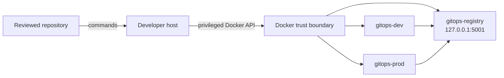

# Threat Model

## Scope

This threat model covers M1: lifecycle automation, two local kind clusters, one
local registry, kubeconfig contexts, Docker networking, and the developer
workstation that hosts them. Later services must update this document before
their implementation is considered operationally ready.

M1 uses synthetic infrastructure and must not process production workloads,
customer data, or production credentials.

## Assets

- Integrity of repository scripts and configuration.
- Availability and isolation of the two local cluster environments.
- Integrity of images stored in or retrieved from the local registry.
- Local kubeconfig credentials and cluster-admin access.
- Docker daemon access and the host workstation.
- Evidence produced by verification commands.

## Trust boundaries

The host-to-Docker boundary is privileged: a user or process controlling the
Docker daemon can normally control the kind nodes and registry and may gain
significant access to the host. The development and production clusters have
separate Kubernetes APIs, but they are not separate physical security domains.

## Threat actors and assumptions

Relevant actors include a malicious or compromised dependency, an untrusted
local process, a contributor proposing unsafe automation, a workload with
cluster access, and an operator making an accidental destructive change.

The model assumes:

- The workstation and Docker installation are maintained by the operator.
- The repository is obtained through a trusted channel and changes are reviewed.
- The local topology is not exposed directly to an untrusted network.
- Only synthetic test inputs are used.

## Threats and M1 controls

| Threat | Impact | Current control | Residual risk |
|---|---|---|---|
| Lifecycle command deletes unrelated resources | Data loss or disrupted local work | Cleanup is scoped to project-owned, explicitly named resources | Bugs or name collisions remain possible; inspect before manual cleanup |
| Malicious image enters local registry | Workload or node compromise | Images are digest-pinned after promotion; CI scans for fixable HIGH/CRITICAL | The local registry is unauthenticated; M8 must enforce signed, approved registries |
| Registry is reachable beyond the intended host/network | Image tampering or disclosure | Bind and network scope are limited by local bootstrap design | Host Docker/network configuration can widen exposure |
| Kubeconfig is disclosed | Cluster-admin access | Kubeconfig remains local and must not be committed | kind credentials are administrative by design |
| Development access is mistaken for production authorization | Unauthorized change to modeled production | Separate clusters; production promotion requires confirmation and a pull-request trailer | GitHub branch protection must still be enabled on the hosting repository |
| Dependency or downloaded tool is compromised | Host or cluster compromise | Tool versions are pinned and changes reviewed | Full provenance verification is not yet comprehensive |
| Partial bootstrap produces misleading success | Incorrect evidence or later failure | Commands fail on errors and `make smoke` checks the running topology | Host-specific races may still occur |
| Resource exhaustion | Local denial of service | Documented prerequisites, bounded topology, explicit cleanup | Both clusters share one host failure domain |
| Secret is committed | Credential disclosure | Repository policy prohibits secrets; reporting guidance exists | Automated secret scanning depends on CI/tool availability |
| Documentation overstates capability | Hiring/review integrity risk | Implemented/planned labels and evidence requirements | Manual review is still required |

## Explicitly accepted M1 risks

- The registry is a development convenience and is not a production-grade,
  authenticated, highly available registry.
- kind nodes are containers on one host; environment isolation is logical.
- Local cluster kubeconfigs provide broad administrative access.
- Admission control, signed-image enforcement, default-deny networking, scoped
  workload RBAC, external secrets, and runtime detection are planned, not
  implemented.
- There is no guarantee of confidentiality from a user who controls the host or
  Docker daemon.

## Security requirements for future milestones

Workloads are promoted by digest through Git (M4). Remaining before a signed
release claim: a signing workflow and admission verification. GitOps
permissions, controller credentials, and recovery access are defined for the
local topology; EKS still requires OIDC access, least privilege, state
protection, network exposure, budgets, and teardown.

Planned admission controls include non-root execution, restricted capabilities,
read-only root filesystems where compatible, resource requests and limits,
approved registries, ownership labels, and default-deny networking. Listing
these controls here does not claim they exist in M1.

## Verification and review

Security-relevant changes include lifecycle resource selection, Docker port or
network exposure, kubeconfig handling, tool downloads, registry configuration,
and any future cloud credential path. They require explicit review and negative
tests where practical. Vulnerability reporting is described in
[SECURITY.md](../SECURITY.md).
